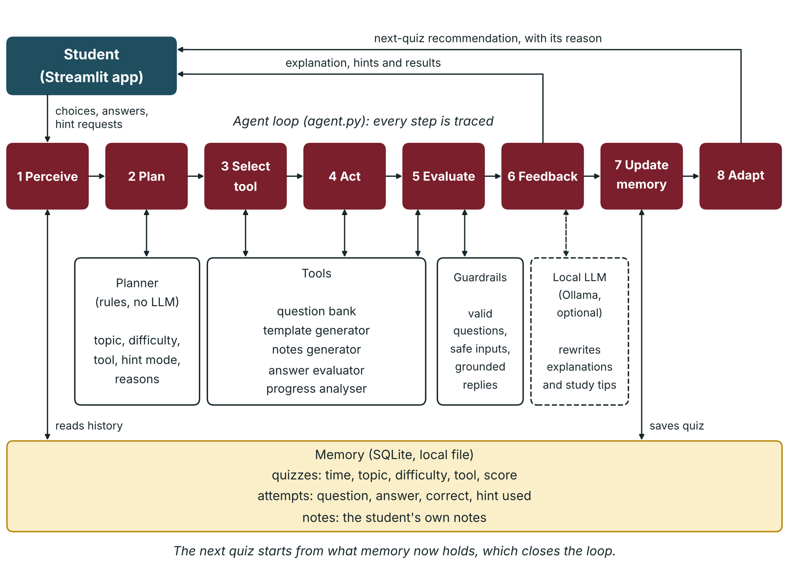

# Quiz Tutor Agent

An adaptive, tool-using agent that helps university students revise Python, statistics and machine learning basics. It plans each quiz from the student's history, chooses between question tools, marks answers with code, remembers results and adapts the next quiz, and explains its decisions.

Built for DAT404 Intelligent and Generative Agents, Assignment D (Sherubtse College, Royal University of Bhutan).

The agent runs **entirely on your own laptop**: no API key, no cloud service, and no data leaves the machine. The local AI tutor (Ollama) is optional. Without it, every AI button falls back to stored explanations and rule-based advice.



## What the agent does

1. **Perceives:** reads past quizzes, recent scores and the weakest topic from memory (SQLite).
2. **Plans:** a rule-based planner picks the topic, difficulty, number of questions, tool and hint mode, and records a reason for each choice ("Why this quiz?").
3. **Selects a tool and acts:** question bank, template-based question generator, or a generator that builds fill-in-the-blank questions from the student's own notes.
4. **Evaluates and gives feedback:** answers are marked by code, never by a language model.
5. **Updates memory and adapts:** the finished quiz is saved and the next quiz is recommended.
6. **Guardrails:** every question is validated, notes uploads are checked, and the optional local language model only rewrites facts the agent already holds (every number in its reply must appear in those facts).

## Requirements

- Python 3.13 (developed with 3.13.17)
- The packages in `requirements.txt`: streamlit, pandas, matplotlib, pytest, pypdf, python-docx, python-pptx
- **Optional:** [Ollama](https://ollama.com) with the `qwen2.5:0.5b` model, for the AI tutor buttons

## Setup

Run these from the project folder.

**Windows (PowerShell)**

```
python -m venv .venv
.venv\Scripts\Activate.ps1
pip install -r requirements.txt
```

If PowerShell says running scripts is disabled, run `Set-ExecutionPolicy -Scope CurrentUser RemoteSigned` once and try again.

**macOS / Linux**

```
python3 -m venv .venv
source .venv/bin/activate
pip install -r requirements.txt
```

### Optional: the AI tutor

```
ollama pull qwen2.5:0.5b
```

Make sure Ollama is running before you start the app. The first AI reply is slow while the model loads, and a reply takes about 40 seconds on the development laptop. Everything else in the app is instant and does not wait for the model.

## Run the app

```
streamlit run app.py
```

Streamlit opens the app in your browser. Pages: Home, Quiz, Progress, My Notes and Evaluation. The first run creates the local database `data/quiz_agent.db` automatically.

## Run the tests

```
python -m pytest -q
```

All 92 unit tests should pass. They cover the planner, tools, generators, memory, guardrails, notes (including file types), the notes quiz, the agent loop, and the LLM helper.

## Run the evaluation

```
python -m evaluation.run_eval
```

The evaluation uses temporary databases, so your real quizzes and notes are not touched, and a fixed random seed (42). It writes tables, `metrics.json` and charts to `evaluation/results/`. It covers:

- 135 full quiz runs (generation, completion, answer marking, speed)
- 30 decision test cases (tool, difficulty and topic), including boundary cases
- 17 injected faults (safety and fallback behaviour)
- checks of generated and notes questions
- harder tests: independent answer check, comparison with a plain random quiz, simulated students, messy notes and a stress test

Test cases are in `evaluation/test_cases.json`. Results are in `evaluation/results/`.

## Project structure

```
app.py                    Streamlit interface
agent/
  agent.py                The agent loop
  planner.py              Rule-based decisions with reasons
  tools.py                Question bank, answer evaluator, progress analyser
  generators.py           Template-based question generator
  notes.py, notes_quiz.py Student notes and notes-based questions
  memory.py               SQLite memory
  guardrails.py           Validation and privacy (erase all data)
  llm.py                  Optional local language model (Ollama)
data/                     Question banks
evaluation/               Evaluation scripts, test cases and results
tests/                    Unit tests
docs/                     Report and architecture diagram
```

## Privacy

- Notes, quiz history and answers are stored only in a local SQLite file, which is excluded from Git.
- No API key is needed and no data is sent to a cloud service.
- The **Delete all my data** button in the app erases every stored quiz, answer and note.

## Limitations

- The agent was evaluated with simulated students, not real ones, so the results show that it tracks a student's level and do not prove that students learn more.
- The decision thresholds (80, 50 and 70) were set by hand and not tuned on data.
- The question bank is small (12 questions per topic) and the generator has 12 templates, so variety is limited, especially in Statistics.
- The notes generator works only with notes written in full sentences. In the messy-notes test, 3 of 8 files gave a usable quiz.
- The local AI tutor (0.5B parameters) is slow, and its quality was tested with only 4 calls per setting.

See the technical report in `docs/` for the full design, evaluation and failure analysis.

## Use of AI tools

Claude (Anthropic's AI assistant) was used during development for design discussion, code, the evaluation scripts, the interface and drafting the report. All tests and evaluation scripts were run by the author, and the author is responsible for the submitted work.
